# Diagram templates

Copy one template, then replace the synthetic Shop names with the elements that the change touches.
Pick the template with the checklist and the view table in [`diagrams.md`](diagrams.md).
Each template follows the notation and Mermaid rules in that file.
The C4 views copy the view types of Structurizr. The other templates use UML-style Mermaid diagrams.

| Template | Structurizr or UML equivalent | Mermaid form |
| --- | --- | --- |
| [System Landscape](#system-landscape) | `systemLandscape` view | `flowchart` |
| [System Context](#system-context) | `systemContext` view | `flowchart` |
| [Container](#container) | `container` view | `flowchart` |
| [Component](#component) | `component` view | `flowchart` |
| [Dynamic: sequence form](#dynamic-sequence-form) | `dynamic` view | `sequenceDiagram` |
| [Dynamic: collaboration form](#dynamic-collaboration-form) | `dynamic` view as Structurizr draws it | `flowchart` |
| [Deployment](#deployment) | `deployment` view | `flowchart` |
| [Sequence: request and response](#sequence-request-and-response) | UML sequence diagram | `sequenceDiagram` |
| [Sequence: asynchronous work](#sequence-asynchronous-work) | UML sequence diagram | `sequenceDiagram` |
| [Sequence: agent handoff](#sequence-agent-handoff) | UML sequence diagram | `sequenceDiagram` |
| [Database: entity relationship](#database-entity-relationship) | ER diagram, crow's foot notation | `erDiagram` |
| [Database: UML tables](#database-uml-tables) | UML class diagram with `<<table>>` | `classDiagram` |
| [State](#state) | UML state machine | `stateDiagram-v2` |

Do not copy the Structurizr filtered, custom, or image views. Draw a smaller C4 view instead.

## System Landscape

Use a System Landscape view when a change touches more than one software system that the organization owns.
Show people and software systems only. Do not show containers.

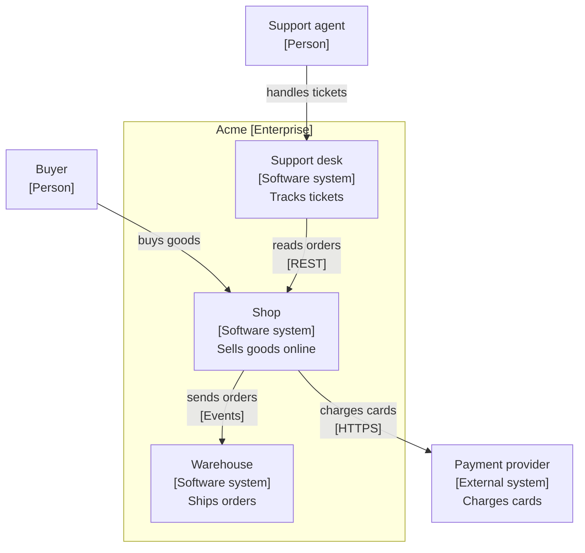

Title: `System Landscape view: Acme`.

## System Context

Use a System Context view when a change adds a user type or an external dependency of one software system.
Show the one system in scope, its people, and its external systems.

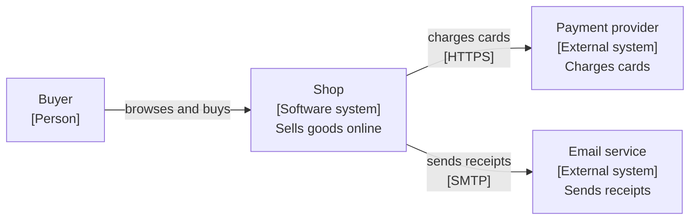

Title: `System Context view: Shop`.

## Container

Use a Container view when a change adds, removes, or rewires an application, a data store, a queue, or an external system.
Put the containers of the system in scope inside one `subgraph`.

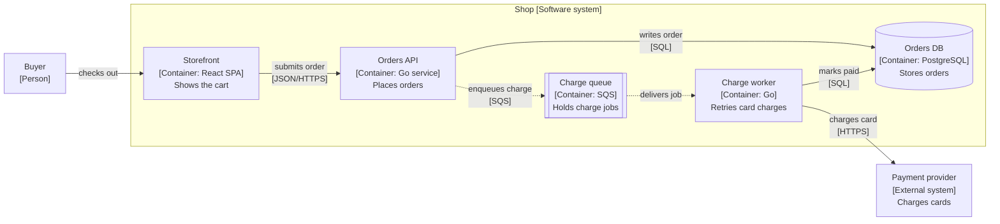

Title: `Container view: Shop checkout`.
Legend: cylinder = data store, double-edged box = queue, dashed arrow = asynchronous message.

## Component

Use a Component view when a change restructures the inside of one container.
Put the components of that container inside one `subgraph`. Show the neighbor containers outside it.

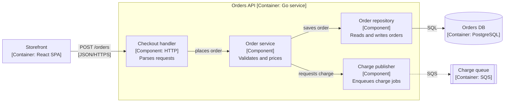

Title: `Component view: Orders API`.

## Dynamic: sequence form

Use a Dynamic view when the order of messages between C4 elements matters, for example a new step in checkout.
Use C4 element names as participants. Number each step with `autonumber`.

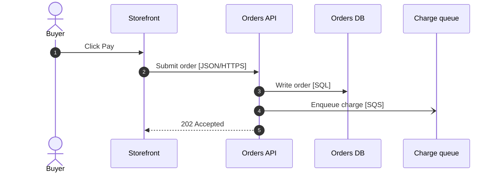

Title: `Dynamic view: Shop checkout`.

## Dynamic: collaboration form

Use the collaboration form when the reader needs the C4 layout and the order together.
Structurizr draws dynamic views this way. Put the step number in front of each relationship label.

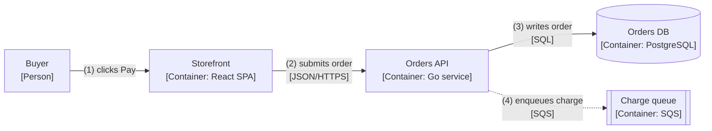

Title: `Dynamic view: Shop checkout`.

## Deployment

Use a Deployment view when a change moves a container to a new runtime, host, cluster, region, or environment.
Nest one `subgraph` per deployment node. Show each container instance inside the node that runs it.

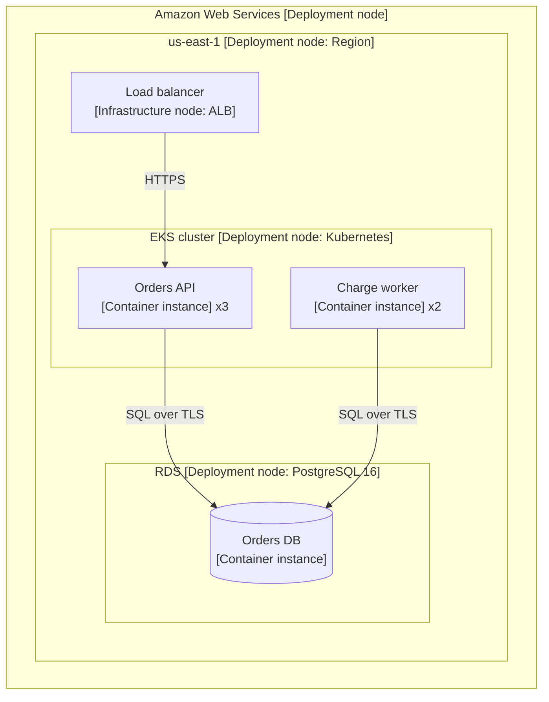

Title: `Deployment view: Shop, production`.

## Sequence: request and response

Use this sequence when a change adds a synchronous call or a new error path.
Show the success path and each error path in one `alt` block.

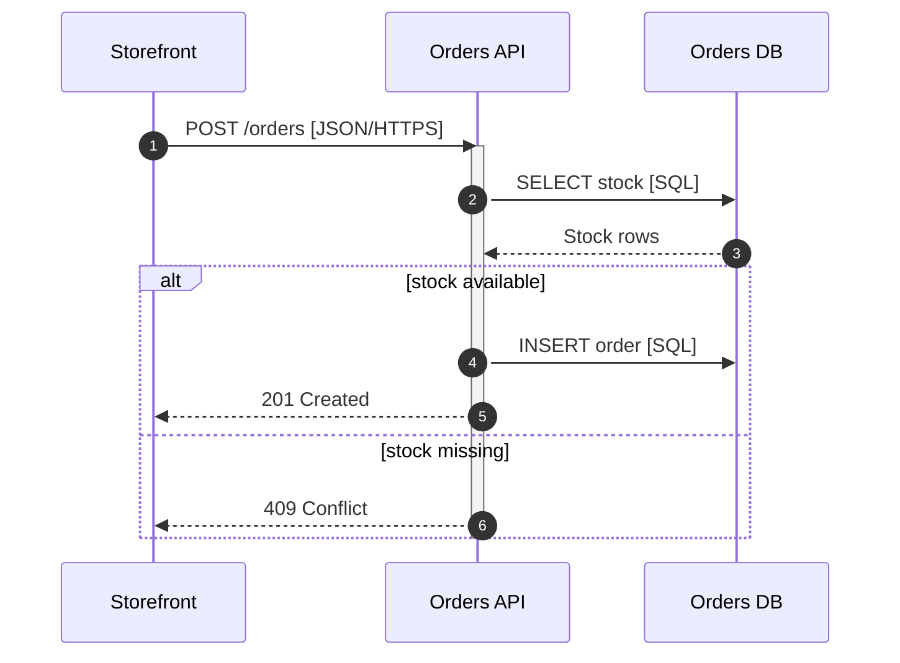

## Sequence: asynchronous work

Use this sequence when a change adds a queue, a retry, a callback, or a background job.
Use `-)` for an asynchronous message. Show the retry with `loop` and the failure with `opt`.

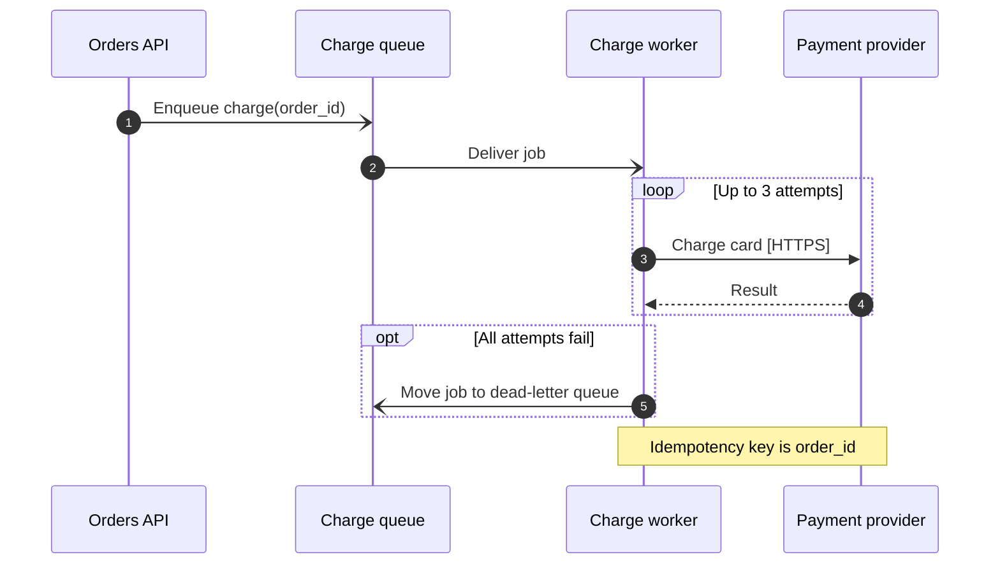

## Sequence: agent handoff

Use this sequence when a change alters the order of handoffs between skills, agents, or sub-agents.
Show each artifact that moves between participants.

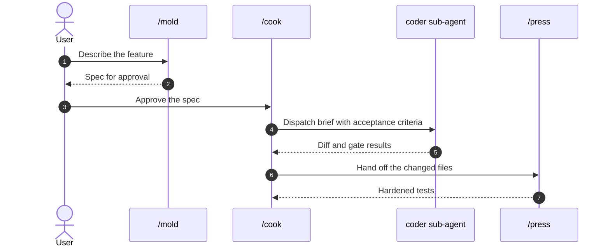

## Database: entity relationship

Use an entity relationship diagram when a change adds or alters tables, columns, keys, or relationships.
Show only the tables that the change touches, plus the tables that they reference.
Mark keys with `PK`, `FK`, and `UK`.

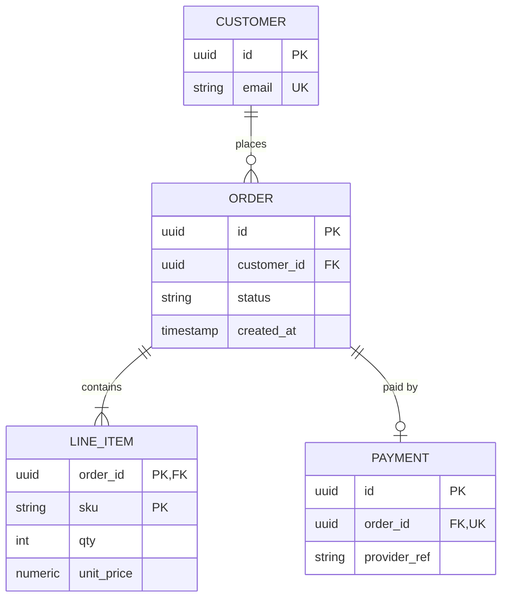

Cardinality: `||` exactly one, `o|` zero or one, `|{` one or more, `o{` zero or more.

## Database: UML tables

Use the UML table form when the reader needs column types, constraints, or indexes that the entity relationship form cannot show.
Mark each class with the `<<table>>` stereotype. Put multiplicities on each association.

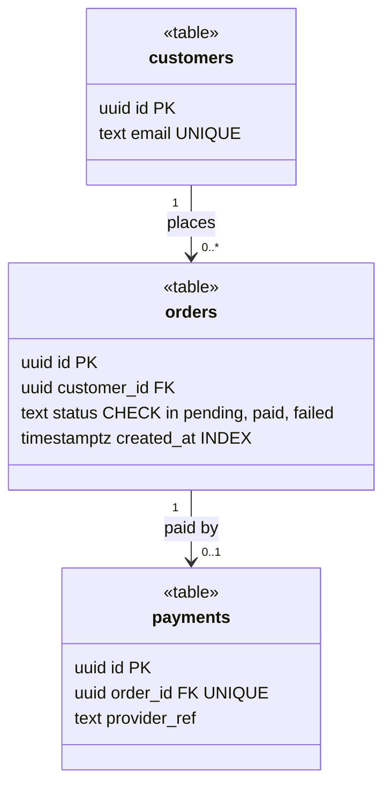

## State

Use a state diagram when a change adds a status field, a lifecycle, or a new transition.
Label each transition with the event that causes it.

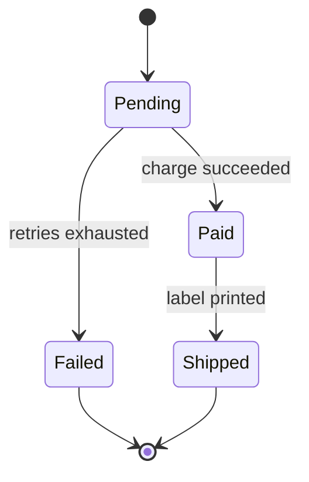
