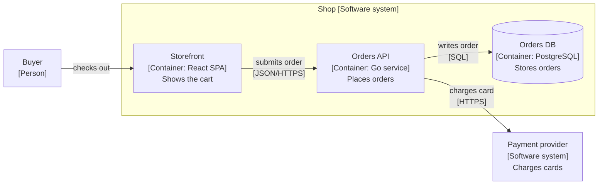

# Diagram vocabulary

Use this reference when a skill adds an architecture or flow diagram to a spec, a pull request body, or an explanation.
The vocabulary comes from the [C4 model](https://c4model.com/).
C4 defines the abstractions and the zoom levels. It does not fix a notation, so draw C4 views in Mermaid.

## Pick one view

Ask which question the reader has. Draw the one view that answers it.

| Reader question | View | Mermaid form |
| --- | --- | --- |
| Who uses the system, and which external systems does it depend on? | C4 System Context | `flowchart` |
| Which runnable or deployable units exist, and how do they talk? | C4 Container | `flowchart` |
| Which components inside one container change, and how do they connect? | C4 Component | `flowchart` |
| In which order do messages move between elements? | C4 Dynamic | `sequenceDiagram` |
| Where does each container run? | C4 Deployment | `flowchart` with one `subgraph` per node |
| How does data or control move through modules? | flow | `flowchart` |
| Which states and transitions does one element have? | state | `stateDiagram-v2` |

Prefer the System Context and Container views. They are sufficient for most changes.
Draw a Component view only for the one container that the change restructures.
Draw a Dynamic view only for a complex or recurring interaction.
Do not draw the C4 Code level. The source code is the code view.
A change inside one module usually needs no C4 view. Use a flow or a sequence instead.

## C4 abstractions

- **Person:** a human user or role.
- **Software system:** the highest unit of value that one team owns and delivers.
- **Container:** a separately runnable or deployable unit, such as an application, a CLI, a function, or a data store.
  A C4 container is not a Docker container.
- **Component:** a group of related code behind one interface inside one container.

Keep one zoom level in each diagram.
A Container view also shows the people and external systems that connect to the containers.
A Component view also shows the containers and external systems that connect to the components.

## Notation rules

- Give each diagram a title that names the view and its scope, for example `Container view: Shop checkout`.
- Label each element with its name, its type and technology, and one line of responsibility.
  For example: `Pay["Payment provider [Software system] Charges cards"]`.
- Draw each relationship in one direction.
  Label it with its intent, and add the protocol or technology between containers.
- Add a legend when a shape, a color, or a line style carries meaning.
- Show only the elements that the change touches, plus their direct neighbors.
  Keep a diagram to 15 nodes or fewer.

## Mermaid rules

- Draw C4 views with `flowchart`, not with the Mermaid `C4Context` family.
  Mermaid marks its C4 syntax as experimental.
- A repository that keeps a C4 model in Structurizr DSL or LikeC4 is the source of truth.
  Derive the view from that model. Do not draw a second, divergent copy.
- Quote a label that holds punctuation.
- Never use `end` as a node id. Use ` ` for a line break.
- Do not add theme or style directives.

## Example

This example is synthetic.

Title: `Container view: Shop checkout`.

## Alternatives

C4 covers static structure well. Use another model when the question is different:

- arc42 is a documentation template. It pairs with C4 views and adds quality goals, decisions, and risks.
- UML sequence, state, and deployment diagrams add precise behavior where C4 stays informal.
- A data flow diagram with trust boundaries supports a threat model.
- ArchiMate covers enterprise views that cross business, application, and technology layers.
