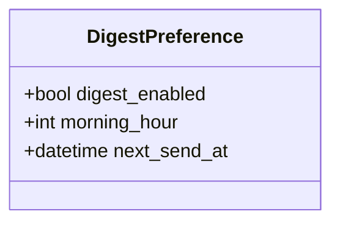
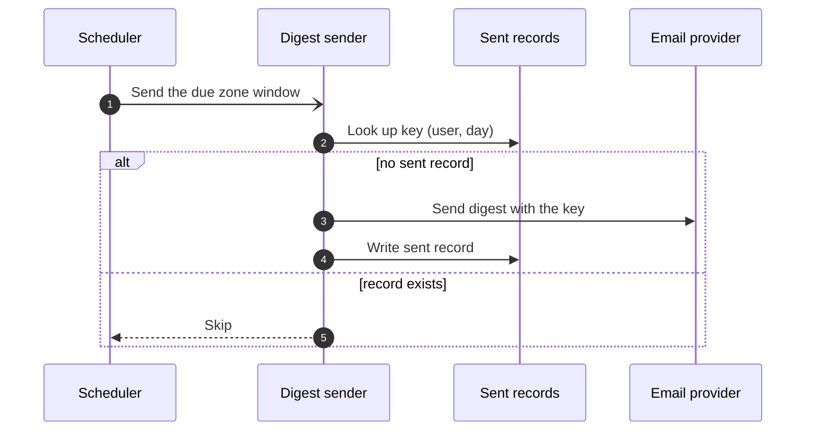
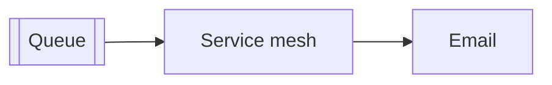

# Three spec drafts: daily email digest

The problem: a daily digest has many routine parts and two risky ones. The risky ones are safe delivery on provider retries, and send timing across time zones. The email provider drops a repeated send that carries the same idempotency key within 24 hours.

## Draft X

**Answer:** Build the digest with a preferences page, an admin switch, sign-in checks, a template, a sender, and a scheduler. Each part ships in the same release.



Title: `Component view: digest preference`.
Legend: + = public field.

- Problem: the settings page has no digest fields, and no job sends a digest.
- Decision: add the fields, the switch, the template, the scheduler, and the sender in one release.
- Preferences: add digest_enabled and morning_hour columns; set the form width to 480 pixels.
- Admin: name the switch enable_daily_digest and place it after the mail switch.
- Sign-in checks: reuse the session check of the settings page.
- Template: use a 24-pixel heading and an 8-pixel gap between items.
- Scheduler: poll each minute and store next_send_at for each user.
- Sender: issue the provider call, retry on timeout, and then append the sent row.
- Template copy: the subject line is "Your daily digest", the preheader shows the item count, and the footer links to the settings page.
- Defaults: digest_enabled starts false, and morning_hour starts at 8.
- Logging: the sender logs the user id, the zone, and the provider status code for each call.
- Admin copy: the switch label reads "Daily digest", and its help text reads "Send one summary email each morning."
- Tests: one snapshot test of the template, and one test for each default.
- Crux: the form layout on small screens.
- Placement:

```text
slice: notifications
spine step: workflow
public interface: def send_digest(user_id: int) -> None
private: def due_users(now: datetime) -> list[int]; def render(user_id: int) -> str
crust delta: two new columns
arrows: scheduler -> sender
```

- Rejected: a checkbox list for the admin page, because a switch takes less space and matches the other switches on the same settings page.
- Out of scope: dark mode for the template.
- Verification: each field accepts its default value.

## Draft Y

**Answer:** A user gets one digest a day at a local morning hour, from a sender that is safe to retry and a scheduler that is safe to run late.



Title: `Dynamic view: Digest delivery`.
Legend: open arrowhead = asynchronous message.

- Problem: a user is tired of many emails. A support engineer must be able to say why a digest did not arrive.
- Decision: one keyed digest per user and local day, sent by zone window.
- Routine parts, one line each: the preferences page, the admin switch, sign-in checks, and the template follow existing patterns.
- Crux: safe delivery. The provider drops a repeat of the stable (user, local-day) key for 24 hours. Concurrent sends and retries use that key, and every retry happens before local midnight, so it stays inside that window. The sent record only saves a provider call.
- Crux: timing. The scheduler groups users by zone and sends the window that is due. A late run sends the missed window once, until local midnight, and after that it logs a skip.
- Placement:

```text
slice: notifications
spine step: workflow
public interface: the digest preference (on or off, morning hour)
private: zone windows; sent records in the job store
crust delta: one new preference field
arrows: scheduler -> digest sender -> email provider
```

- Rejected: send exactly at the minute for each user needs one timer per user. Skip a late digest loses mail with no signal.
- Out of scope: a weekly digest. Per-channel digests such as chat.
- Verification: replay a provider timeout and a late scheduler run, and check that each user gets one digest.

## Draft Z

**Answer:** Use a message queue, a cache, a container platform, and a service mesh to send a daily digest. This stack scales to any number of users.



Title: `Container view: Digest platform`.

- Problem: users get too many emails.
- Decision: a queue, a cache, a container platform, and a mesh.
- Crux: scale.
- Placement:

```text
slice: TBD
spine step: workflow
public interface: a scalable digest platform
private: the queue, the cache, and the mesh
crust delta: a new platform
arrows: queue -> mesh -> email
```

- Rejected: a simple cron job, because it does not scale, it is old-fashioned, and it cannot grow with the product over the next few years.
- Out of scope: bad design.
- Verification: the platform scales.

Source: our own work. The depth rule paraphrases <https://www.hellointerview.com/blog/staff-level-system-design> (link only; no text copied).
