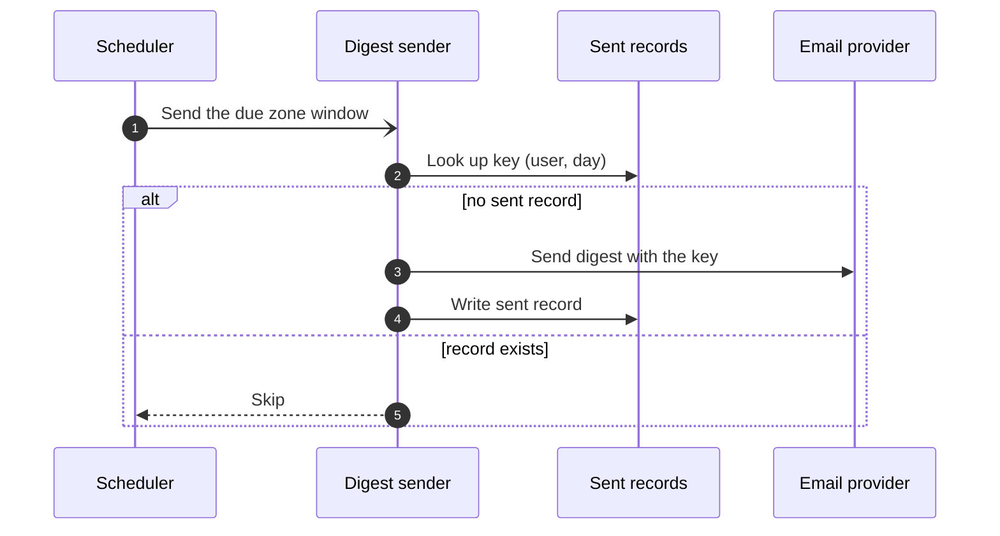

# Three spec drafts: daily email digest

The problem: a daily digest has many routine parts and two risky ones. The risky ones are safe delivery on provider retries, and send timing across time zones.

## Draft X

**Answer:** Build the digest with a preferences page, an admin switch, sign-in checks, a template, a sender, and a scheduler.

- Preferences page: two paragraphs on fields and layout.
- Admin switch: two paragraphs on flags and roles.
- Sign-in checks: two paragraphs on the session rules.
- Template: two paragraphs on the layout.
- Sender: two paragraphs on the provider call.
- Scheduler: two paragraphs on the clock.
- Each part gets the same depth. No part is marked as risky.

## Draft Y

**Answer:** A user gets one digest a day at a local morning hour. The sender is safe to retry, and the scheduler is safe to run late.

Title: `Dynamic view: Digest delivery`.
Legend: open arrowhead = asynchronous message.

- Problem: a user is tired of many emails. A support engineer must be able to say why a digest did not arrive.
- Routine parts, one line each: the preferences page, the admin switch, sign-in checks, and the template follow existing patterns.
- Crux one, safe delivery: each digest has a stable key per user and day. The provider call is repeated only when no sent record exists for that key. A timeout with no record is retried with the same key.
- Crux two, timing: the scheduler groups users by zone and sends the window that is due. A late run sends the missed window once, not twice.
- Rejected: send exactly at the minute for each user needs one timer per user. Skip a late digest loses mail with no signal.
- Out of scope: a weekly digest. Per-channel digests such as chat.

## Draft Z

**Answer:** Use a message queue, a cache, a container platform, and a service mesh to send a daily digest.

- Queue: a distributed log for events.
- Cache: an in-memory store for preferences.
- Platform: containers with autoscaling.
- Mesh: encrypted service links.
- Alternatives: none.
- Out of scope: bad design.

Source: our own work. The depth rule paraphrases <https://www.hellointerview.com/blog/staff-level-system-design> (link only; no text copied).
