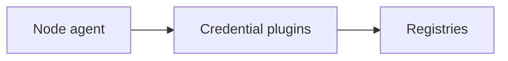
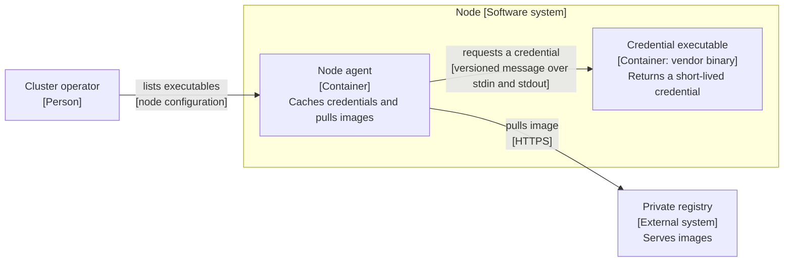
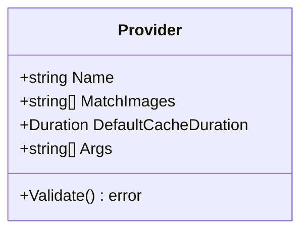

# Three spec drafts: image pull credentials

The problem: a node agent holds registry credential code for each vendor. Operators wait for agent releases to add a registry.

## Draft X

**Answer:** Make image credentials pluggable. A flexible model will support every registry.



Title: `Container view: Credentials`.

- Problem: credentials are hard to manage.
- Decision: a flexible extension model for credentials.
- Crux: flexibility.
- Placement:

```text
slice: TBD
spine step: everywhere that credentials are used
public interface: a flexible plugin API
private: the plugin details
crust delta: whatever the plugins need
arrows: TBD
```

- Rejected: the current approach, because it is not flexible enough for new vendors, for new clusters, or for the needs of every team that runs a cluster today.
- Out of scope: nothing breaks.
- Verification: it works.

## Draft Y

**Answer:** The node agent gets registry credentials from an external executable that speaks a versioned message format over standard input and output.



Title: `Container view: Image pull credentials`.

- Problem: a cluster operator waits for an agent release to add a registry. Maintainers carry vendor code that they cannot test well.
- Decision: an external executable for each registry, behind a versioned message contract.
- Seam: the agent reads a list of executables from node configuration. It sends the image name. The executable returns a credential and a cache duration.
- Owners: the executable owns the secret and its lifetime. The agent owns the cache and the pull.
- Failure modes: a crash or a timeout fails that pull with an event. The agent does not fall back to anonymous pulls.
- Crux: the version contract between agent and executable, and the cache rules for short-lived credentials.
- Placement:

```text
slice: node credentials
spine step: infra (image pull)
public interface: credential request and response, message version v1
private: executable lookup from node configuration; cache by image pattern
crust delta: new executable message contract
arrows: node agent -> credential executable
```

- Rejected: a network service per node needs a daemon to run and patch. Vendor code stays out of the agent because it keeps the release wait.
- Out of scope: removing the built-in vendor code in this release. Credentials for things other than images.
- Verification: contract tests per version, and one manual pull from a private registry.

## Draft Z

**Answer:** Add a plugin configuration block to the node agent. Two new flags point at the file and at the binary directory.



Title: `Component view: Provider configuration`.
Legend: + = public field or method.

- Problem: the node agent has no configuration type for providers, and its flag parser has no flag for a configuration path.
- Decision: add a provider configuration file with a list of providers, and two new flags.
- Config fields:

```yaml
apiVersion: credentialprovider/v1
providers:
  - name: example-registry
    matchImages: ["*.example.com"]
    defaultCacheDuration: 5m
    args: ["--region", "eu"]
```

- Flags: `--image-credential-provider-config` takes the configuration path. `--image-credential-provider-bin-dir` takes the binary directory. Both default to empty, and the agent skips every provider when either flag is empty.
- Go struct: a `Provider` type with five fields. `Validate` returns an error when `Name` is empty, when `MatchImages` is empty, or when `DefaultCacheDuration` is below one second.
- Matching: split each image name on `/`. Compare each part with the same part of the pattern. Accept `*` only in the first part.
- Defaults: a missing `defaultCacheDuration` means one minute. A missing `args` list means no arguments.
- Errors: a missing binary logs `provider binary not found` at warning level. The agent then skips that provider and tries the next one.
- Logging: each lookup logs the provider name, the image, and a cache hit or miss at debug level.
- Tests: one table test for each pattern form: exact host, wildcard first part, host with a port number, and path prefix.
- Crux: the speed of the image match on each pull.
- Placement:

```text
slice: node agent
spine step: infra (image pull)
public interface: func LoadProviders(path string) ([]Provider, error)
private: func (p *Provider) Validate() error; func matchImage(pattern, image string) bool
crust delta: two new flags; one new configuration file
arrows: node agent -> provider binary
```

- Rejected: a map of providers keyed by name, because a list keeps the file order.
- Out of scope: a configuration reload without a restart.
- Verification: unit tests for each field, for each flag default, and for each match pattern.

Source: <https://github.com/kubernetes/enhancements/blob/master/keps/sig-node/2133-kubelet-credential-providers/README.md>. The upstream text is Apache-2.0. These drafts are our own work and copy no sentence.
