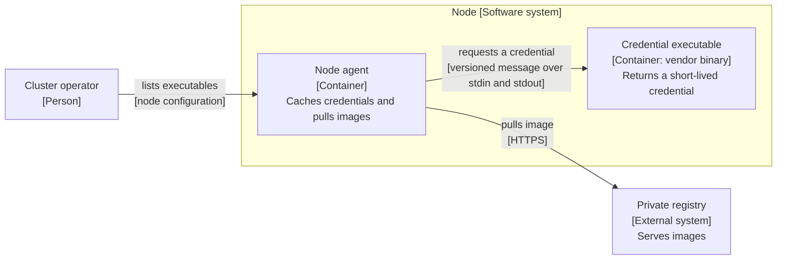

# Three spec drafts: image pull credentials

The problem: a node agent holds registry credential code for each vendor. Operators wait for agent releases to add a registry.

## Draft X

**Answer:** Make image credentials pluggable.

- Problem: credentials are hard to manage.
- Solution: a flexible extension model for credentials.
- Alternatives: none.
- Out of scope: nothing breaks.
- Verification: it works.

## Draft Y

**Answer:** The node agent runs an external executable to get registry credentials. The executable speaks a versioned message format over standard input and output.



Title: `Container view: Image pull credentials`.

- Problem: a cluster operator waits for an agent release to add a registry. Maintainers carry vendor code that they cannot test well.
- Seam: the agent reads a list of executables from node configuration. It sends the image name. The executable returns a credential and a cache duration.
- Owners: the executable owns the secret and its lifetime. The agent owns the cache and the pull.
- Failure modes: a crash or a timeout fails that pull with an event. The agent does not fall back to anonymous pulls.
- Crux: the version contract between agent and executable, and the cache rules for short-lived credentials.
- Rejected: a network service per node needs a daemon to run and patch. Keeping vendor code in the agent keeps the release wait.
- Out of scope: removing the built-in vendor code in this release. Credentials for things other than images.
- Verification: contract tests per version, and one manual pull from a private registry.

## Draft Z

**Answer:** Add a plugin configuration block to the node agent.

- Config fields:

```yaml
apiVersion: credentialprovider/v1
providers:
  - name: example-registry
    matchImages: ["*.example.com"]
    defaultCacheDuration: 5m
    args: ["--region", "eu"]
```

- Flags: two new flags for the node agent, one for the config path and one for the binary directory.
- Go struct: a `Provider` type with five fields and a validation function.
- Verification: unit tests for each field.

Source: <https://github.com/kubernetes/enhancements/blob/master/keps/sig-node/2133-kubelet-credential-providers/README.md>. The upstream text is Apache-2.0. These drafts are our own work and copy no sentence.
