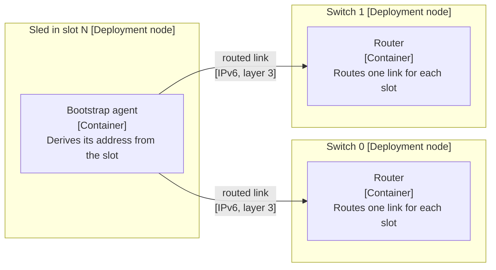

# Three spec drafts: bootstrap network

The problem: at first power-on, sleds must find each other with no address server. The network shape is the open choice.

## Draft X

**Answer:** Assign each switch port a fixed prefix.

| Switch | Port | Prefix |
|---|---|---|
| sw0 | 1 | fd00:1::/64 |
| sw0 | 2 | fd00:2::/64 |
| sw0 | 3 | fd00:3::/64 |
| sw1 | 1 | fd00:4::/64 |

- Table continues for all 32 ports of both switches.
- Verification: ping each prefix.

## Draft Y

**Answer:** Use routed layer 3 links between sleds and switches. Do not use one shared layer 2 domain. Each sled derives its own address from its slot.

Title: `Deployment view: Rack bootstrap network`.

- Problem: an installer must bring up a rack with no address server and little time. A broadcast problem on a shared domain can take down every sled at once.
- Decision: routed links with addresses derived from the slot.
- Reasons: a fault stays on one link. No spanning tree or broadcast storm can form. Addresses are predictable, so no discovery step is needed.
- Rejected: a shared layer 2 domain is simpler to draw but spreads faults. A hybrid adds both sets of failure modes.
- Crux: the rule that maps a slot to an address, and what happens when a sled sits in the wrong slot.
- Out of scope: the customer-facing overlay network. Support for a rack with a single switch.

## Draft Z

**Answer:** Use a routed network.

- Problem: the rack needs a network.
- Solution: a routed network for bootstrap.
- Alternatives: none.
- Out of scope: everything else.
- Verification: sleds can talk.

Source: <https://rfd.shared.oxide.computer/rfd/0063>. The upstream site grants no reuse license. These drafts paraphrase the topic and copy no sentence.
