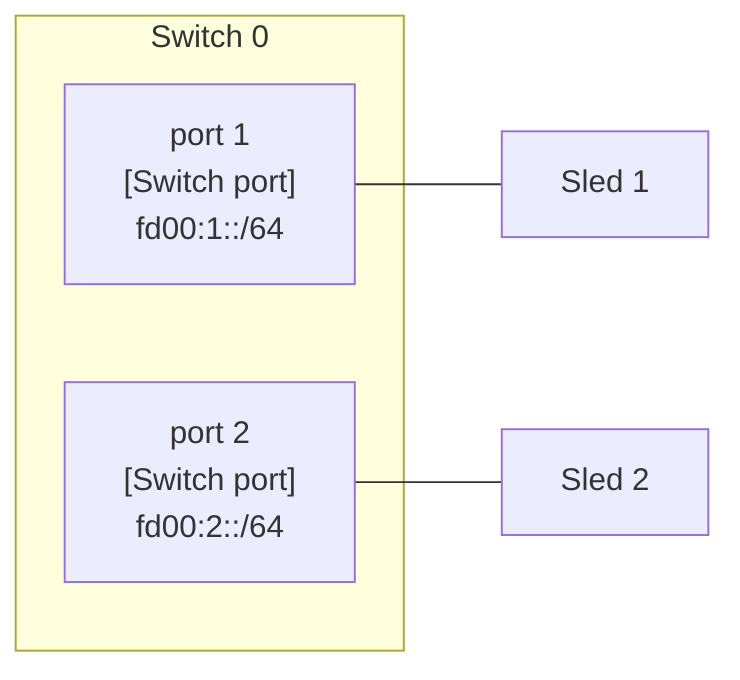
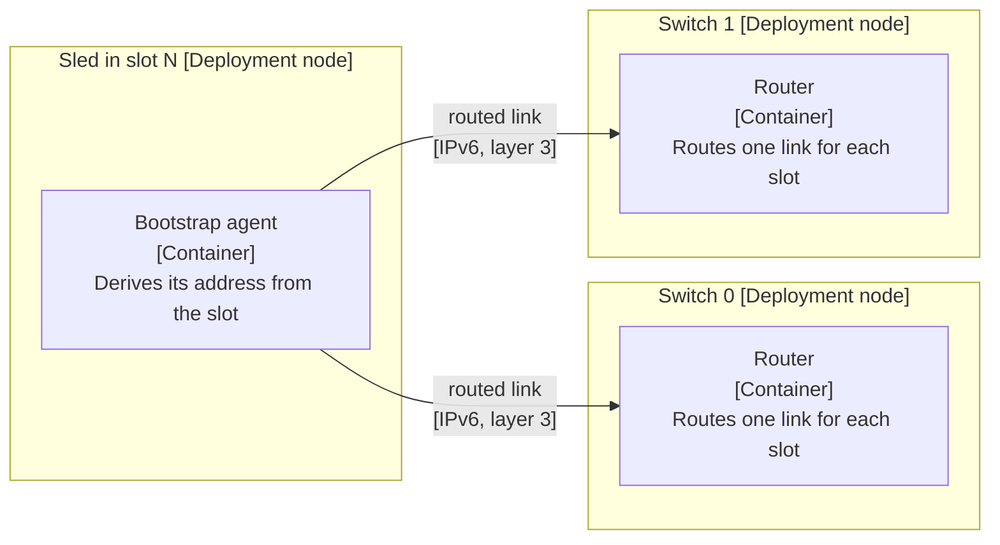
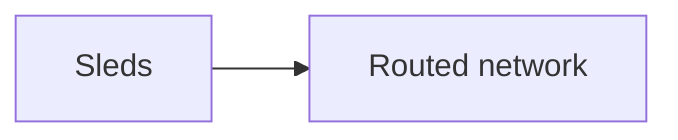

# Three spec drafts: bootstrap network

The problem: at first power-on, sleds must find each other with no address server. The network shape is the open choice.

## Draft X

**Answer:** Assign each switch port a fixed prefix. The installer loads the prefix table into both switches.



Title: `Deployment view: port prefixes`.

| Switch | Port | Prefix |
|---|---|---|
| sw0 | 1 | fd00:1::/64 |
| sw0 | 2 | fd00:2::/64 |
| sw1 | 1 | fd00:4::/64 |

- Problem: the switches have no port prefix table.
- Decision: a fixed /64 prefix for each port; the table continues for all 32 ports.
- Crux: the prefix width.
- Placement:

```text
slice: switch config
spine step: none
public interface: set_port_prefix(switch, port, prefix)
private: next_free_prefix(table) -> prefix; write_table(switch, rows)
crust delta: one new prefix table
arrows: installer tool -> switch
```

- Rejected: /80 prefixes, because /64 prefixes suit address autoconfiguration and keep the table to one row for each port on each switch.
- Out of scope: prefixes for a second rack.
- Verification: ping each prefix.

## Draft Y

**Answer:** Use routed layer 3 links between sleds and switches, not one shared layer 2 domain, with each sled address derived from its slot.



Title: `Deployment view: Rack bootstrap network`.

This view shows where the router and the bootstrap agent run, and which links join them.

- Problem: an installer must bring up a rack with no address server and little time. A broadcast problem on a shared domain can take down every sled at once.
- Decision: routed links with addresses derived from the slot.
- Reasons: routed links limit broadcast faults. Slot-derived addresses avoid an address server; peer discovery remains a separate requirement.
- Rejected: a shared layer 2 domain is simpler to draw but spreads faults. A hybrid adds both sets of failure modes.
- Crux: the rule that maps a slot to an address.
- Placement:

```text
slice: rack bootstrap
spine step: none
public interface: the slot-to-address rule
private: route setup on each switch; address derivation on each sled
crust delta: one address rule that switch and sled software share
arrows: bootstrap agent -> switch router
```

- Open: [TBD] what a sled does when it sits in the wrong slot.
- Out of scope: the customer-facing overlay network. Support for a rack with a single switch.
- Verification: bring up a rack with no address server, and check that each sled reaches both switches.

## Draft Z

**Answer:** Use a modern routed network that is simple, fast, and reliable. Routed networks are what modern racks use.



Title: `Deployment view: Network`.

- Problem: the rack needs a good network. Today there is no network at first power-on, and that is a problem for everyone who installs, builds, or runs a rack.
- Decision: a routed network for bootstrap, since routed networks are the modern choice.
- Goals: reliability, simplicity, speed of install, low cost, easy support, and a good experience for the installer, the firmware engineer, and the operator.
- Crux: getting the network right.
- Placement:

```text
slice: networking
spine step: none
public interface: the network
private: the network details
crust delta: a routed network
arrows: sleds -> network
```

- Rejected: a shared network, because routed networks are better, more modern, and easier to grow as the rack and the team grow over time.
- Risks: the network may have problems. The team will monitor it.
- Out of scope: everything else.
- Verification: sleds can talk. The operator sees no alerts. The installer is happy.

Source: <https://rfd.shared.oxide.computer/rfd/0063>. The upstream site grants no reuse license. These drafts paraphrase the topic and copy no sentence.
