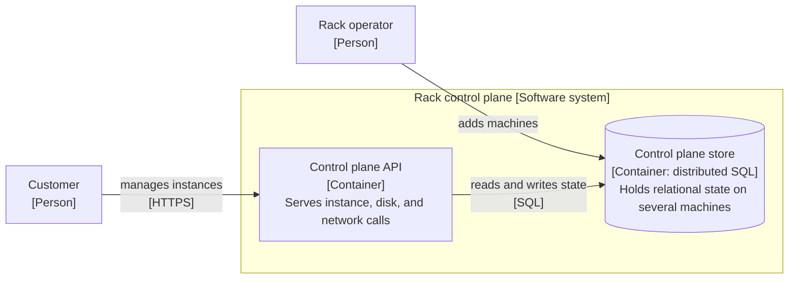

# Three spec drafts: control plane store

The problem: a rack-scale cloud needs a relational, consistent store that survives machine loss and ships inside an appliance.

## Draft X

**Answer:** Use distributed SQL for the control plane.

- Problem: we need a database.
- Solution: pick a distributed SQL database.
- Alternatives: none.
- Out of scope: other databases.
- Verification: it passes tests.

## Draft Y

**Answer:** Store control plane state in a relational schema.

```sql
CREATE TABLE instance (
  id UUID PRIMARY KEY,
  project_id UUID NOT NULL,
  state TEXT NOT NULL,
  time_created TIMESTAMPTZ NOT NULL
);
CREATE INDEX ON instance (project_id, state);
```

- Test log: 40 lines of a failover run, pasted in full.
- Verification: the schema loads without error.

## Draft Z

**Answer:** Use a distributed SQL store, and accept two named risks. The team will test failure behavior early and link the results.



Title: `Container view: Control plane store`.
Legend: cylinder = data store.

- Problem: the control plane needs a relational, consistent store that survives the loss of a machine. A customer sees any outage as an API outage.
- Goals: relational model, consistent writes, scale by adding machines, a license that allows shipping in an appliance.
- Decision: a distributed SQL store.
- Rejected: a single-node database with replicas needs a manual or fragile failover and does not scale out. A key-value store moves joins and consistency into our own code.
- Risks: the team has little operating experience, and the license terms may change. Each risk has an owner and a check.
- Crux: operating maturity. The fault tests and the results live in a linked report, not in this doc.
- Out of scope: a store that spans regions.

Source: <https://rfd.shared.oxide.computer/rfd/0110>. The upstream site grants no reuse license. These drafts paraphrase the topic and copy no sentence.
