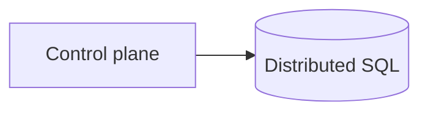
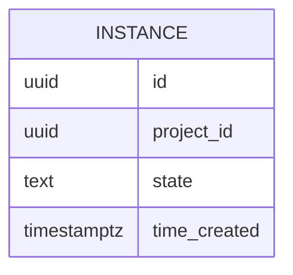
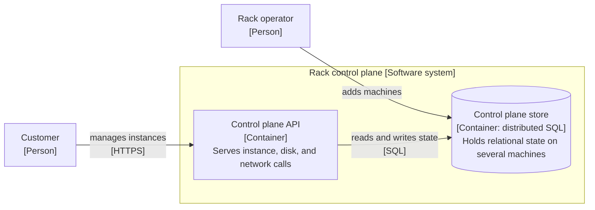

# Three spec drafts: control plane store

The problem: a rack-scale cloud needs a relational, consistent store that survives machine loss and ships inside an appliance.

## Draft X

**Answer:** Use distributed SQL for the control plane. It is the modern choice.



Title: `Container view: Store`.

- Problem: we need a database.
- Decision: pick a distributed SQL database.
- Crux: picking the right database.
- Placement:

```text
slice: TBD
spine step: infra
public interface: a database
private: the database internals
crust delta: a new database
arrows: control plane -> database
```

- Rejected: other databases, because distributed SQL is modern.
- Out of scope: other databases.
- Verification: it passes tests.

## Draft Y

**Answer:** Store control plane state in a relational schema.



Title: `Database view: instance table`.

- Problem: the control plane has no instance table.
- Decision: a relational schema in SQL:

```sql
CREATE TABLE instance (
  id UUID PRIMARY KEY,
  project_id UUID NOT NULL,
  state TEXT NOT NULL,
  time_created TIMESTAMPTZ NOT NULL
);
CREATE INDEX ON instance (project_id, state);
```

- Crux: the index on project and state. It serves the instance list page.
- Placement:

```text
slice: control plane storage
spine step: infra
public interface: def insert_instance(conn, project_id, state) -> UUID
private: def list_by_state(conn, project_id, state) -> list[Row]
crust delta: one new table
arrows: control plane API -> instance table
```

- Test log: 40 lines of a failover run, pasted in full. The run stops one node at minute three. Writes pause for nine seconds. Then the cluster elects a new leader.
- Rejected: a text primary key, because UUID keys spread writes across key ranges and avoid a hot range on the newest rows.
- Out of scope: the disk and network tables, which come next.
- Verification: the schema loads without error.

## Draft Z

**Answer:** Use a distributed SQL store, accept two named risks, and link the results of early failure tests.



Title: `Container view: Control plane store`.
Legend: cylinder = data store.

- Problem: the control plane needs a relational, consistent store that survives the loss of a machine. A customer sees any outage as an API outage.
- Goals: relational model, consistent writes, scale by adding machines, a license that allows shipping in an appliance.
- Decision: a distributed SQL store.
- Rejected: a single-writer replicated store does not meet the required write scale-out. A key-value store is rejected because it shifts relational queries into application code.
- Risks: the operations owner validates recovery; the release owner verifies redistribution rights before selection.
- Crux: operating maturity. The fault tests and the results live in a linked report, not in this doc.
- Placement:

```text
slice: control plane storage
spine step: infra
public interface: none; the API keeps its current contract
private: schema and queries behind the data access layer
crust delta: one new store dependency
arrows: control plane API -> control plane store
```

- Out of scope: a store that spans regions.
- Verification: the linked fault-test report shows that writes survive the loss of one machine.

Source: <https://rfd.shared.oxide.computer/rfd/0110>. The upstream site grants no reuse license. These drafts paraphrase the topic and copy no sentence.
