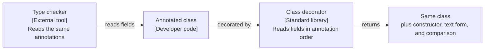

# Three spec drafts: data-holding classes

The problem: classes that only hold data repeat the same methods by hand. Type checkers need the field list from annotations.

## Draft X

**Answer:** A class decorator reads the annotated attributes of a class and adds the usual methods. The class stays a normal class.



Title: `Flow: data-holding class`.

- Problem: a developer writes the same constructor and comparison for every data class. A type checker needs the fields without a plugin.
- Seam: the decorator is the only entry point. A per-field helper overrides a default or leaves a field out of comparison.
- Invariants: field order is annotation order. A field with a mutable default fails at class creation, not at use.
- Failure modes: a class that already defines a method keeps its own method.
- Crux: the rule for default values and for inheritance of fields.
- Rejected: the tuple-based factory ties the class to tuple behavior, such as equality with plain tuples and iteration. Generating a restricted attribute layout by default changes class creation, so a decorator cannot do it safely.
- Out of scope: runtime validation of field types. Serialization to other formats.

## Draft Y

**Answer:** Generate the constructor and comparison methods from the annotations.

- Constructor, in pseudo-code:

```python
for f in fields:
    lines.append(f"self.{f.name} = {f.name}")
body = "\n    ".join(lines)
exec(f"def __init__(self, {params}):\n    {body}", globals_, ns)
```

- Comparison: build a tuple of the fields in order, then compare the two tuples.
- Text form: join the field names and values into one string.
- Verification: one test per generated method.

## Draft Z

**Answer:** Reduce boilerplate for data classes.

- Problem: data classes have too much code.
- Solution: a feature that writes the code for the developer.
- Alternatives: none.
- Out of scope: other improvements.
- Verification: developers write less code.

Source: <https://github.com/python/peps/blob/main/peps/pep-0557.rst>. The upstream text is public domain. These drafts are our own work and copy no sentence.
