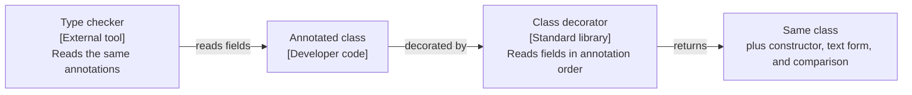
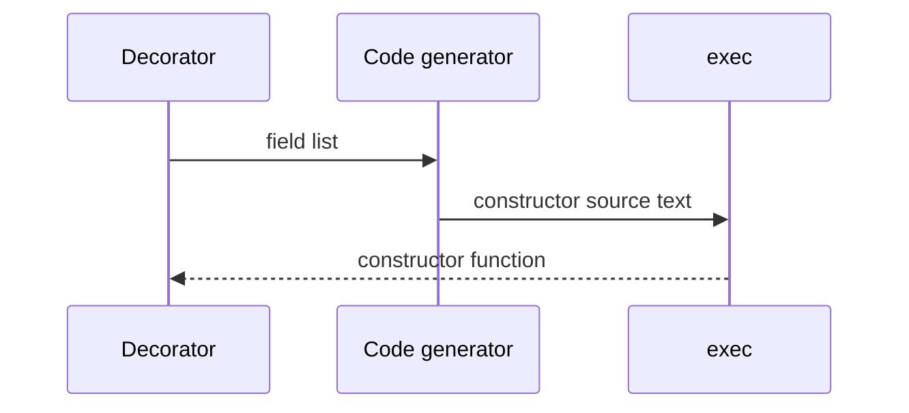
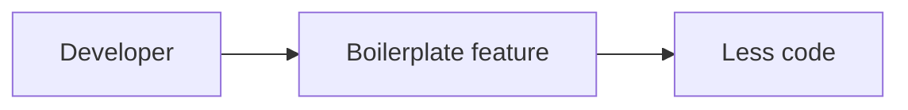

# Three spec drafts: data-holding classes

The problem: classes that only hold data repeat the same methods by hand. Type checkers need the field list from annotations.

## Draft X

**Answer:** A class decorator reads the annotated attributes of a class, adds the usual methods, and leaves it a normal class.



Title: `Flow view: data-holding class`.

- Problem: a developer writes the same constructor and comparison for every data class. A type checker needs the fields without a plugin.
- Decision: a class decorator that reads the annotations.
- Seam: the decorator is the only entry point. A per-field helper overrides a default or leaves a field out of comparison.
- Invariants: field order is annotation order. A field with a list, dict, or set default fails at class creation, not at use.
- Failure modes: a class that already defines its own constructor, representation, or equality method keeps that method. A class that asks for ordering and already defines an ordering method fails at class creation.
- Crux: the rule for default values and for inheritance of fields.
- Open: [TBD] whether classes get ordering by default.
- Placement:

```text
slice: standard library data classes
spine step: none
public interface: def dataclass(cls); def field(*, default, compare)
private: method generation from annotations; default-value checks
crust delta: two new public names
arrows: decorator -> class annotations
```

- Rejected: the tuple-based factory ties the class to tuple behavior, such as equality with plain tuples and iteration. A restricted attribute layout by default is rejected because it changes class creation, which a decorator cannot do safely.
- Out of scope: runtime validation of field types. Serialization to other formats.
- Verification: a type checker reads the fields of a decorated class with no plugin.

## Draft Y

**Answer:** Generate the constructor and comparison methods from the annotations. The generator builds source text for each method.



Title: `Dynamic view: constructor generation`.

- Problem: each data class needs a generated constructor, text form, and equality method.
- Decision: build source text and run it with `exec`:

```python
for f in fields:
    lines.append(f"self.{f.name} = {f.name}")
body = "\n    ".join(lines)
exec(f"def __init__(self, {params}):\n    {body}", globals_, ns)
```

- Comparison: build a tuple of the fields in order, then compare the two tuples.
- Crux: the speed of the generated constructor.
- Open: [TBD] the slots default.
- Placement:

```text
slice: data classes
spine step: none
public interface: def dataclass(cls)
private: def _make_init(fields, globals_) -> str; def _make_eq(fields) -> str
crust delta: one new decorator
arrows: decorator -> exec
```

- Rejected: one closure per field, because one generated function runs faster at call time.
- Out of scope: keyword-only fields.
- Verification: one test per generated method.

## Draft Z

**Answer:** Reduce boilerplate for data classes.



Title: `Flow view: data classes`.

- Problem: data classes have too much code.
- Decision: a feature that writes the code for the developer.
- Crux: less code.
- Open: [TBD] ordering.
- Placement:

```text
slice: standard library
spine step: everywhere
public interface: a feature that writes the methods
private: the generated code
crust delta: a new feature
arrows: TBD
```

- Rejected: doing nothing, because boilerplate is bad for developers, bad for reviewers, and bad for the long-term health of every code base.
- Out of scope: other improvements.
- Verification: developers write less code.

Source: <https://github.com/python/peps/blob/main/peps/pep-0557.rst>. The upstream text is public domain. These drafts are our own work and copy no sentence.
