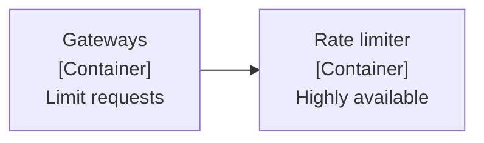
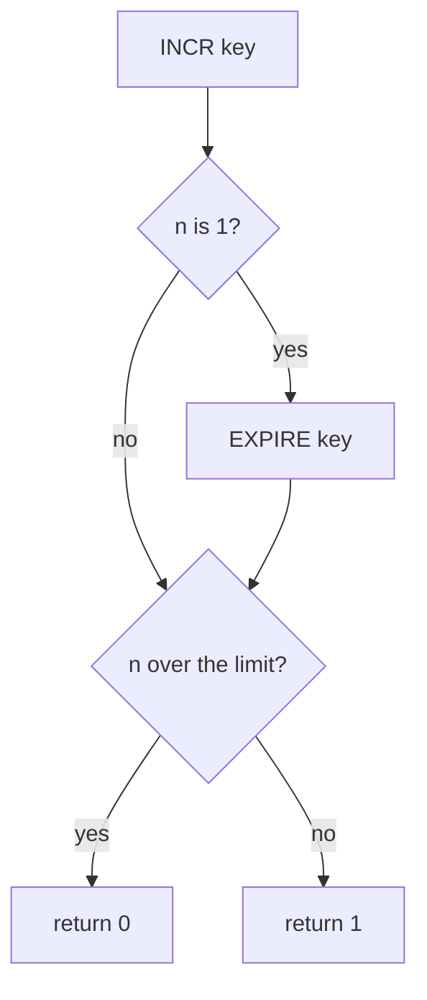
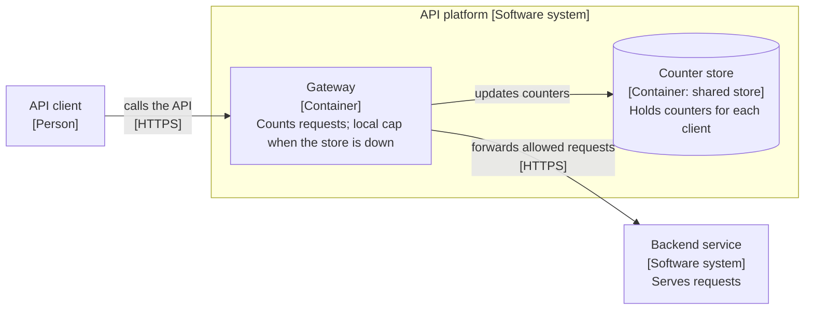

# Three spec drafts: limiter during a store outage

The problem: when the counter store is down, a gateway must choose between rejecting and allowing requests.

## Draft X

**Answer:** Make the rate limiter highly available, so that it never goes down and every team can rely on it.



Title: `Container view: Rate limiter`.

- Problem: the limiter must not go down. When it goes down, clients suffer, backend teams suffer, and the on-call engineer has a bad night.
- Decision: add replicas, add failover, add monitoring, and add alerts, so that the limiter is always available.
- Goals: availability, resilience, observability, and peace of mind for clients, for backend teams, and for the on-call engineer.
- Principles: avoid a single point of failure. Use defense in depth. Prefer automation over manual steps.
- Approach: build a world-class limiter platform with modern tools, a clear roadmap, and strong ownership.
- Benefits: happier clients, safer backends, fewer incidents, and faster onboarding for new teams.
- Stakeholders: clients, backend teams, the platform team, support, and leadership.
- Timeline: start soon. Deliver in phases. Improve over time.
- Communication: announce the change early, write a post for client teams, and update the runbook.
- Success metrics: fewer incidents, faster recovery, and higher satisfaction scores.
- Ownership: the platform team owns the limiter, with support from every backend team.
- Documentation: one page that explains the limiter to every client team, every backend team, and the support desk.
- Crux: high availability.
- Open: [TBD] client messaging.
- Placement:

```text
slice: gateway
spine step: entry
public interface: a highly available limiter
private: replicas and failover
crust delta: a new limiter platform
arrows: gateways -> limiter
```

- Rejected: a single limiter, because it can go down, and a limiter that goes down hurts every client, every backend team, and the on-call engineer.
- Risks: an outage may still happen. The team will learn from each one.
- Out of scope: downtime.
- Verification: uptime is high, and alerts stay quiet.

## Draft Y

**Answer:** Update counters with one atomic script. The gateway loads the script once at start.



Title: `Flow view: counter script`.

- Problem: two calls per request race on the counter.
- Decision: one atomic script that calls `INCR` on the client key, calls `EXPIRE` when the count is 1, and returns 0 when the count is over the limit.
- Crux: the script round trip.
- Open: [TBD] the script timeout value.
- Placement:

```text
slice: gateway
spine step: entry
public interface: def allow(client_id: str) -> bool
private: def load_script(conn) -> str; def counter_key(client_id: str) -> str
crust delta: none
arrows: gateway -> counter store
```

- Rejected: `MULTI` and `EXEC`, because a script needs one round trip and keeps the count and the expiry in one step.
- Out of scope: sliding windows.
- Verification: run the script against a local store.

## Draft Z

**Answer:** When the counter store is unreachable, a gateway allows requests under a local per-gateway cap instead of rejecting them.



Title: `Container view: Rate limiter during a store outage`.
Legend: cylinder = data store.

- Problem: a store outage must not become an API outage for every client. Backend teams still need a limit during a traffic spike.
- Decision: fail open, with a fixed local cap on each gateway.
- Reasons: rejecting all traffic hurts every client at once. A local cap bounds the damage of a spike.
- Who is affected: a client may exceed its exact limit for the length of the outage. A backend sees a higher but bounded load.
- Rejected: fail closed, because it turns a store fault into a full outage, even though it protects backends fully. Fail open with no cap leaves backends open to a spike.
- Crux: how to size the local cap, and how fast a gateway returns to exact counts.
- Placement:

```text
slice: gateway rate limiting
spine step: entry
public interface: none new; the outage signal to clients is open
private: the local cap counter; the store health check
crust delta: none
arrows: none new
```

- Open: [TBD] whether clients see a signal, such as a response header, that exact limits are off during the outage.
- Out of scope: per-client billing quotas.
- Verification: stop the store under load, and check that clients keep getting answers and that backend load stays under the local caps.

Source: our own work. Related topic: <https://www.hellointerview.com/learn/system-design/problem-breakdowns/distributed-rate-limiter> (link only; no text copied).
