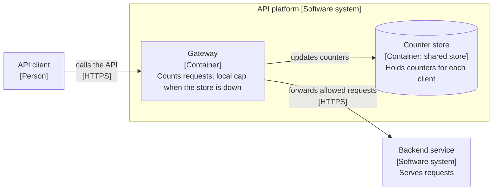

# Three spec drafts: limiter during a store outage

The problem: when the counter store is down, a gateway must choose between rejecting and allowing requests.

## Draft X

**Answer:** Make the rate limiter highly available.

- Problem: the limiter must not go down.
- Solution: add replicas, add failover, add monitoring.
- Alternatives: none.
- Out of scope: downtime.
- Verification: uptime is high.

## Draft Y

**Answer:** Update counters with one atomic script.

```lua
local n = redis.call('INCR', KEYS[1])
if n == 1 then redis.call('EXPIRE', KEYS[1], ARGV[1]) end
if n > tonumber(ARGV[2]) then return 0 end
return 1
```

- Retry: wrap the call in a transaction and retry three times.
- Verification: run the script against a local store.

## Draft Z

**Answer:** When the counter store is unreachable, a gateway allows requests under a local per-gateway cap. It does not reject them.



Title: `Container view: Rate limiter during a store outage`.
Legend: cylinder = data store.

- Problem: a store outage must not become an API outage for every client. Backend teams still need a limit during a traffic spike.
- Decision: fail open, with a fixed local cap on each gateway.
- Reasons: rejecting all traffic hurts every client at once. A local cap bounds the damage of a spike.
- Who is affected: a client may exceed its exact limit for the length of the outage. A backend sees a higher but bounded load.
- Rejected: fail closed protects backends fully but turns a store fault into a full outage. Fail open with no cap leaves backends open to a spike.
- Crux: how to size the local cap, and how fast a gateway returns to exact counts.
- Out of scope: per-client billing quotas.

Source: our own work. Related topic: <https://www.hellointerview.com/learn/system-design/problem-breakdowns/distributed-rate-limiter> (link only; no text copied).
