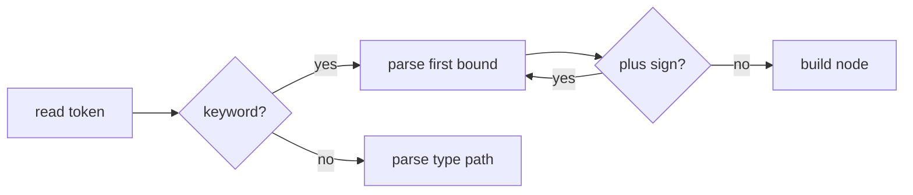
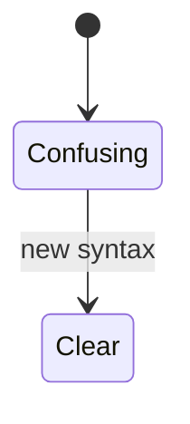
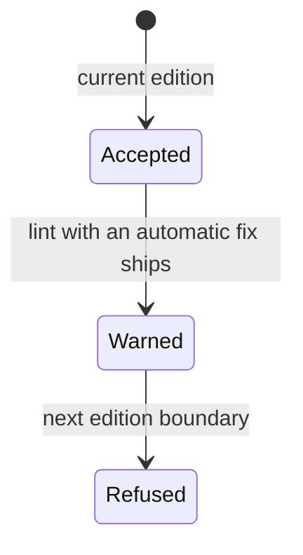

# Three spec drafts: marking trait objects

The problem: a bare trait name used as a type means dynamic dispatch, but it reads like a concrete type. Existing code uses it everywhere.

## Draft X

**Answer:** Define the grammar for the new trait object type. The parser reads an optional keyword before the bounds.



Title: `Flow view: trait object parser`.

- Problem: the parser has no rule for a keyword before a trait bound.
- Decision: an optional keyword token in the type rule:

```ebnf
TraitObjectType = [ "dyn" ] TypeParamBounds ;
TypeParamBounds = Bound { "+" Bound } ;
```

- Crux: the look-ahead cost of the new token.
- Placement:

```text
slice: parser
spine step: none
public interface: fn parse_trait_object(p: &mut Parser) -> TypeNode
private: fn peek_keyword(p: &Parser) -> bool; fn parse_bounds(p: &mut Parser) -> Vec<Bound>
crust delta: one new parser entry point
arrows: type parser -> trait object parser
```

- Rejected: a separate parser pass, because one pass keeps the look-ahead at one token and avoids a second walk over every type in the crate.
- Out of scope: error recovery after a bad bound.
- Verification: parser unit tests for each rule.

## Draft Y

**Answer:** Make trait objects clearer for everyone who reads and writes the language.



Title: `State view: trait objects`.

- Problem: trait objects are confusing. Confusion slows down learning, slows down review, and holds back the growth of the language for years to come.
- Decision: change the syntax so that people understand it at a glance, in every context, for every kind of user.
- Goals: clarity, consistency, teachability, and a better experience for learners, for library authors, and for the language team.
- Principles: be explicit. Be consistent. Be kind to newcomers. Never surprise an experienced user.
- Approach: study how other languages handle this, gather community input, and choose the clearest form.
- Benefits: teaching gets easier. Reviews get faster. The language gets room to grow.
- Timeline: a gradual rollout that respects existing users.
- Community: run a survey. Hold an open call. Publish a summary of the feedback.
- Success: the new syntax feels natural to most people within a year.
- Documentation: update the book, the reference, and the error messages so that they all use the clearer form.
- Crux: clarity.
- Placement:

```text
slice: type syntax
spine step: wherever types appear
public interface: a clearer syntax
private: the details of the change
crust delta: a better syntax
arrows: TBD
```

- Rejected: keeping the syntax as it is, because it is confusing.
- Risks: some people may not like the change. The team will listen to feedback.
- Out of scope: other language changes.
- Verification: learners like it, library authors like it, and the language team likes it.

## Draft Z

**Answer:** Mark each trait object type with a keyword prefix. Warn on the bare form now. Make the bare form an error in a later edition.



Title: `State view: the bare trait object form`.

- Problem: a learner or a library author cannot tell a trait object from a concrete type. The bare form blocks other uses of the bare name.
- Decision: a short prefix keyword before the trait name.
- Rejected: a keyword that looks like an object word implies a different language model. A keyword from another language implies that language's cost model. A wrapper type that looks like a generic type hides that it is built in.
- Migration: a warning lint first, with an automatic fix. A hard error only at the next edition boundary.
- Crux: the migration timing, because the bare form is in most existing crates.
- Placement:

```text
slice: type syntax
spine step: none
public interface: prefix keyword before a trait name in type position
private: the lint and its automatic fix; the edition check
crust delta: one new keyword in type position; one new lint
arrows: none
```

- Open: [TBD] whether the lint warns by default in the current edition or only when a crate opts in.
- Out of scope: change what a trait object means. Remove the bare form inside the current edition.
- Verification: run the lint over the public package registry and count the fixes that apply cleanly.

Source: <https://github.com/rust-lang/rfcs/blob/master/text/2113-dyn-trait-syntax.md>. The upstream text is treated as Apache-2.0, and the MIT half is unconfirmed. These drafts are our own work and copy no sentence.
