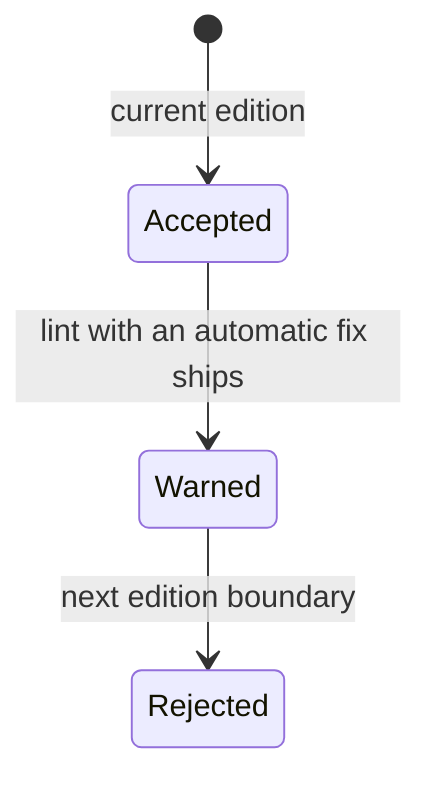

# Three spec drafts: marking trait objects

The problem: a bare trait name used as a type means dynamic dispatch, but it reads like a concrete type. Existing code uses it everywhere.

## Draft X

**Answer:** Define the grammar for the new trait object type.

- Parser rule:

```ebnf
TraitObjectType = [ "dyn" ] TypeParamBounds ;
TypeParamBounds = Bound { "+" Bound } ;
```

- Parser steps: read the keyword, read the first bound, read each added bound, build the node.
- Token table: one new contextual keyword with three look-ahead cases.
- Verification: parser unit tests for each rule.

## Draft Y

**Answer:** Make trait objects clearer.

- Problem: trait objects are confusing.
- Solution: change the syntax so that people understand it.
- Alternatives: none.
- Out of scope: other language changes.
- Verification: learners like it.

## Draft Z

**Answer:** Mark each trait object type with a keyword prefix. Warn on the bare form now. Make the bare form an error in a later edition.



Title: `State view: the bare trait object form`.

- Problem: a learner or reviewer cannot tell a trait object from a concrete type. The bare form blocks other uses of the bare name.
- Decision: a short prefix keyword before the trait name.
- Rejected: a keyword that looks like an object word implies a different language model. A keyword from another language implies that language's cost model. A wrapper type that looks like a generic type hides that it is built in.
- Migration: a warning lint first, with an automatic fix. A hard error only at the next edition boundary.
- Crux: the migration timing, because the bare form is in most existing crates.
- Out of scope: change what a trait object means. Remove the bare form inside the current edition.
- Verification: run the lint over the public package registry and count the fixes that apply cleanly.

Source: <https://github.com/rust-lang/rfcs/blob/master/text/2113-dyn-trait-syntax.md>. The upstream text is treated as Apache-2.0, and the MIT half is unconfirmed. These drafts are our own work and copy no sentence.
