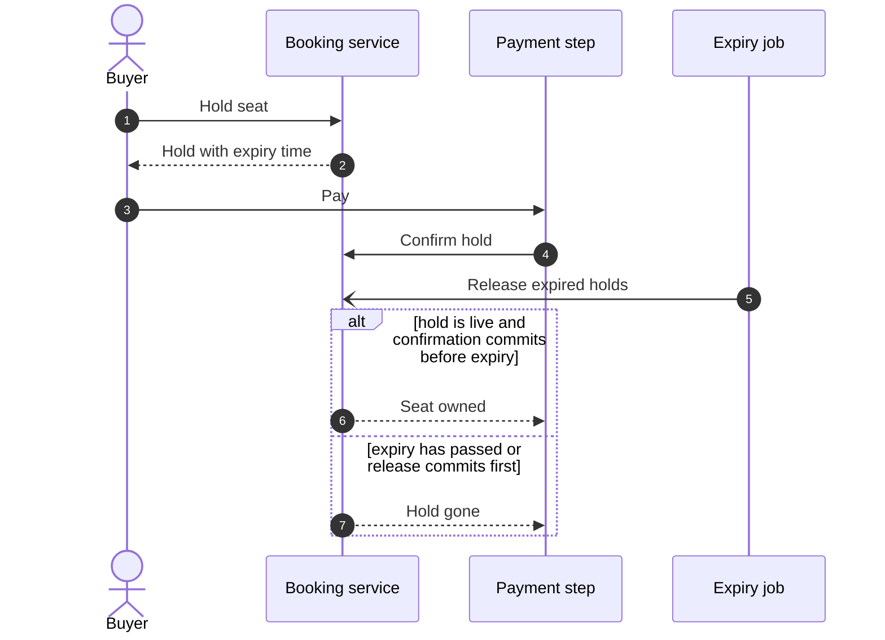
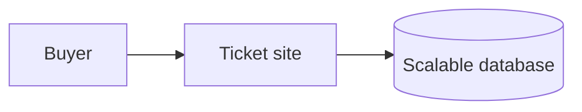
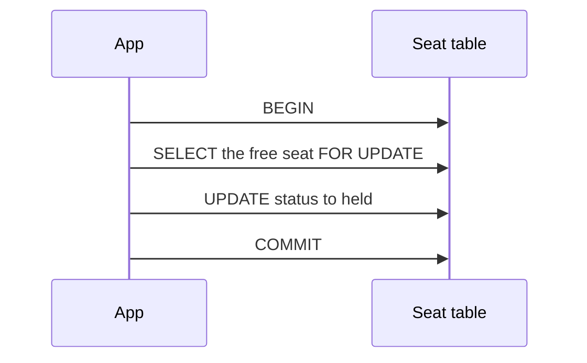

# Three spec drafts: seat hold during checkout

The problem: two buyers must never own one seat. An abandoned checkout must free its seats. On-sale traffic is very high for a few seats.

## Draft X

**Answer:** The booking service holds a seat for one buyer for a fixed time, until payment or expiry, with at most one live hold for each seat.



Title: `Dynamic view: Payment and expiry race`.
Legend: open arrowhead = asynchronous message.

All shown services already exist; only the hold protocol changes.

- Problem: a buyer needs a few minutes to pay. In that time no one else may take the seat, and a buyer who leaves must not block it.
- Goals: no seat sold twice; abandoned seats return to sale.
- Decision: a timed hold that the booking service owns.
- Seam: the booking service owns the hold record. The payment step confirms a hold. The expiry job releases it.
- Invariant: one seat, one live hold or one owner.
- Failure modes: a crash of the expiry job delays release but never double-sells.
- Open: [TBD] what happens to a payment that lands after expiry: a refund, or the seat when it is still free.
- Crux: the race between payment and expiry.
- Placement:

```text
slice: booking
spine step: domain
public interface: hold seat; confirm hold; release expired holds
private: the hold record and its expiry time
crust delta: none; the payment step already confirms bookings
arrows: none new
```

- Rejected: a database lock held for the whole session, because it blocks others and ties up connections. A hold kept only in the client cannot be trusted.
- Out of scope: resale between buyers. Dynamic pricing.
- Verification: a load test of one hundred thousand buyers for one event sells each seat at most once.

## Draft Y

**Answer:** Ensure consistency at scale for every buyer and every event. The right database makes this possible.



Title: `Container view: Ticket site`.

- Problem: the system must be consistent and scale. On-sale days are hard, buyers are unhappy when seats vanish, and organizers lose trust.
- Decision: choose a database that scales and is consistent. Add a cache in front of it.
- Goals: consistency, scale, speed, fairness, and a smooth checkout for buyers, organizers, and on-call engineers.
- Crux: consistency at scale.
- Open: [TBD] late payments.
- Placement:

```text
slice: booking
spine step: domain
public interface: a consistent booking API
private: the database and the cache
crust delta: a scalable database
arrows: ticket site -> database
```

- Rejected: a database that does not scale, because on-sale days need scale, and buyers, organizers, and engineers all depend on a system that stays up.
- Out of scope: inconsistency.
- Verification: a load test passes.

## Draft Z

**Answer:** Lock the seat row while the buyer pays. A cron job frees rows whose hold time has passed.



Title: `Dynamic view: seat lock`.

- Problem: the seat table has no held status.
- Decision: in one transaction, run `SELECT * FROM seat WHERE id = $1 AND status = 'free' FOR UPDATE`, then `UPDATE seat SET status = 'held', held_by = $2 WHERE id = $1`.
- Release: a cron job runs `UPDATE seat SET status = 'free' WHERE held_until < now()` each minute.
- Crux: the lock wait time.
- Open: [TBD] the lock timeout.
- Placement:

```text
slice: booking
spine step: infra
public interface: def lock_seat(conn, seat_id, buyer_id) -> bool
private: def release_expired(conn) -> int
crust delta: one new seat status value
arrows: booking service -> seat table
```

- Rejected: `SKIP LOCKED`, because `NOWAIT` returns faster and lets the page show a taken seat at once.
- Out of scope: a seat map cache.
- Verification: run the statements by hand.

Source: our own work. Related topic: <https://www.hellointerview.com/learn/system-design/problem-breakdowns/ticketmaster> (link only; no text copied).
