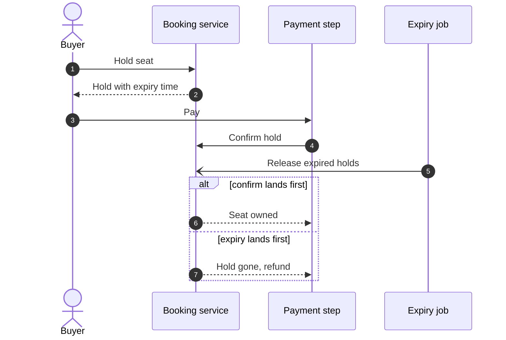

# Three spec drafts: seat hold during checkout

The problem: two buyers must never own one seat. An abandoned checkout must free its seats. On-sale traffic is very high for a few seats.

## Draft X

**Answer:** The booking service holds a seat for one buyer for a fixed time. The hold ends on payment or on expiry. A seat has at most one live hold.



Title: `Dynamic view: Payment and expiry race`.
Legend: open arrowhead = asynchronous message.

- Problem: a buyer needs a few minutes to pay. In that time no one else may take the seat, and a buyer who leaves must not block it.
- Seam: the booking service owns the hold record. The payment step confirms a hold. The expiry job releases it.
- Invariant: one seat, one live hold or one owner.
- Failure modes: a payment that lands after expiry gets a refund and a clear message. A crash of the expiry job delays release but never double-sells.
- Crux: the race between payment and expiry.
- Rejected: a database lock held for the whole session blocks others and ties up connections. A hold kept only in the client cannot be trusted.
- Out of scope: resale between buyers. Dynamic pricing.

## Draft Y

**Answer:** Ensure consistency at scale.

- Problem: the system must be consistent and scale.
- Solution: choose a database that scales and is consistent. Add a cache.
- Alternatives: pick another database.
- Out of scope: inconsistency.
- Verification: load test.

## Draft Z

**Answer:** Lock the seat row while the buyer pays.

```sql
BEGIN;
SELECT * FROM seat WHERE id = $1 AND status = 'free' FOR UPDATE;
UPDATE seat SET status = 'held', held_by = $2 WHERE id = $1;
COMMIT;
```

- Release: a cron job runs `UPDATE seat SET status = 'free' WHERE held_until < now()`.
- Verification: run the statements by hand.

Source: our own work. Related topic: <https://www.hellointerview.com/learn/system-design/problem-breakdowns/ticketmaster> (link only; no text copied).
